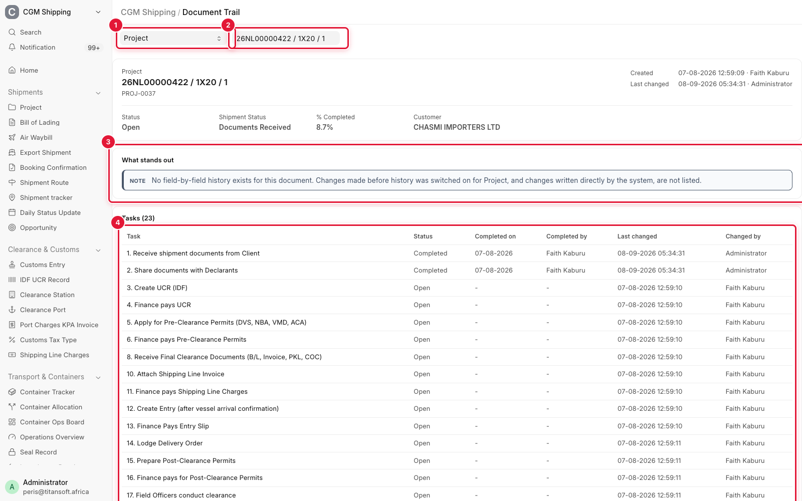
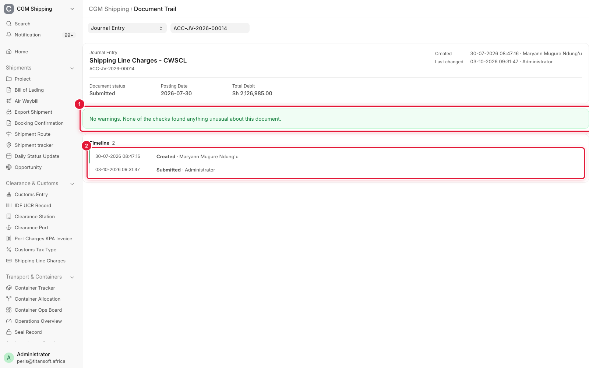
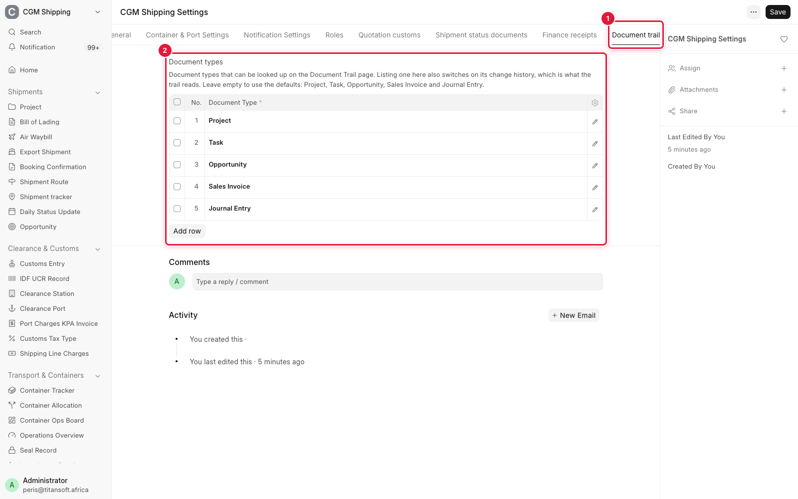

# Document Trail

One page that answers "what happened to this document, and who did it?" Pick a
document and it lays out everything the system recorded about it, in order, with
warnings for the patterns that have gone wrong before.

**Where:** **Document Trail** in the CGM Shipping sidebar, or `/desk/document-trail`.

**Who:** System Manager, Operations Manager, Finance Manager. You also need
permission to read the document itself.

---

## Using it

1. Choose a **Document Type**.
2. Choose the **Document**.

The page fills in on its own. The title links back to the document.

To link straight to a trail, add the type and name to the address:
`/desk/document-trail?doctype=Project&name=PROJ-0037`.

---

## What the page shows

| Section | Contents |
|---------|----------|
| **Header** | Status, key figures, who created the document and who changed it last |
| **What stands out** | Warnings and notes. Green when the checks found nothing |
| **Tasks / Container Trackers** | Projects only: every task and tracker, with who touched it last. Suspect rows are shaded |
| **Timeline** | Changes, comments, assignments, attachments and workflow actions, oldest first |

A change in the timeline lists the fields that moved, as *old value → new value*.

---

## The warnings

Each warning states a fact that can be checked on the document. None of them
guesses at intent.

| Warning | What it means |
|---------|---------------|
| *N of M tasks were last changed by one user within the same few seconds* | One action wrote all of them. Tasks worked one at a time each carry their own timestamp |
| *N completed task(s) have no completion date* | They were not completed through the task steps, so their checks never ran |
| *The project is Completed but N task(s) are still open* | The project status and its tasks disagree |
| *The project is Completed and lists containers, but has no Container Tracker* | Port arrival was never confirmed, so the trackers were never created |
| *The project is Completed but port arrival was never confirmed* | The same gap, seen from the project |
| *This task is Completed but has no completion date* | The single-task form of the second warning |

Notes are informational: the document is cancelled, it replaces another, or no
field history exists for it.

Warnings exist for **Project** and **Task**. Other document types get the header
and the timeline.

---

## What it cannot show

- **Changes from before history was switched on.** Project, Task and Opportunity
  kept no field history until this page was introduced. Older changes on those
  appear only as comments, assignments and the "last changed" stamp.
- **What a direct system write changed.** Some actions write to the database
  without recording history. The timeline shows *Last changed* with the user and
  time, and *No field history was recorded for this change*. The warnings above
  are built from the evidence such a write leaves behind.
- **Which button was pressed.** The trail shows who and when, and what the data
  looks like afterwards.

---

## Choosing which document types are available

**CGM Shipping Settings**, tab **Document trail**, table **Document types**.

The defaults are Project, Task, Opportunity, Sales Invoice and Journal Entry. Add
a row to offer another type on the page. Child tables and settings pages cannot be
listed.

Adding a type here also switches on its change history, which is what the
timeline reads. An emptied table means the defaults, not nothing.

---

## Related guides

- [CGM Shipping Settings](settings.md) - the Document trail tab
- [Operations](operations.md) - how a project is meant to reach Completed
