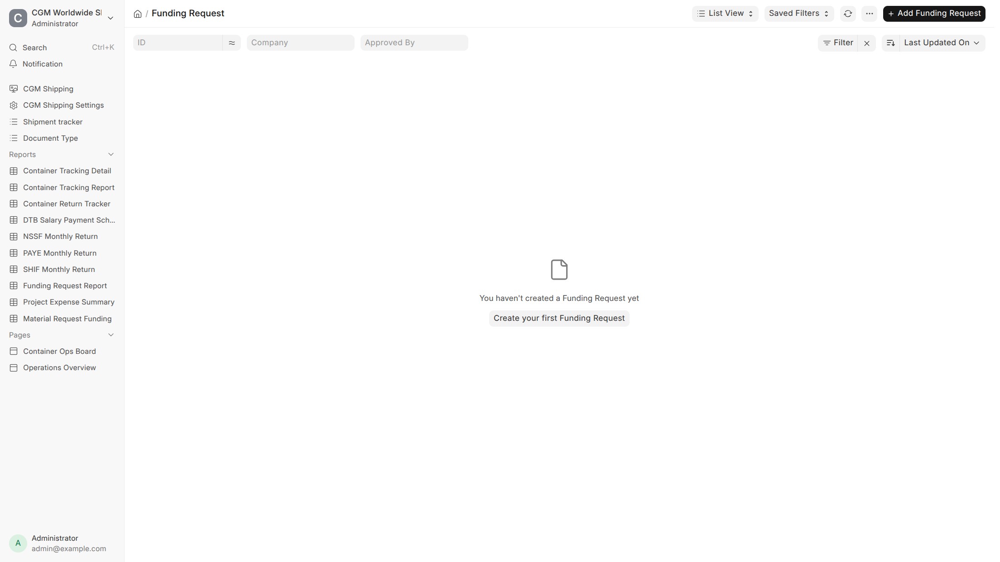
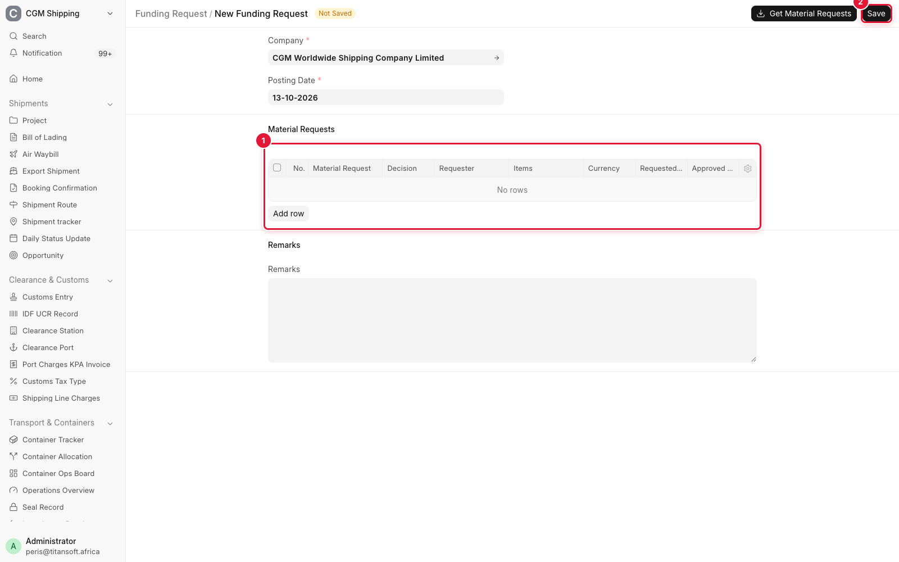
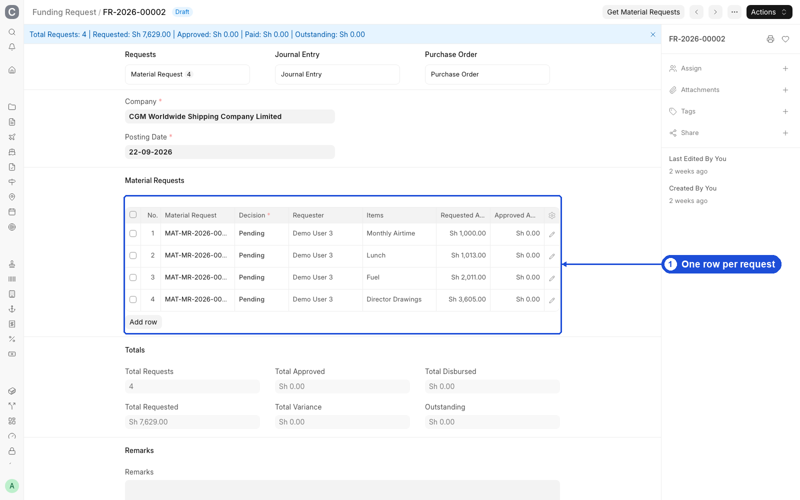
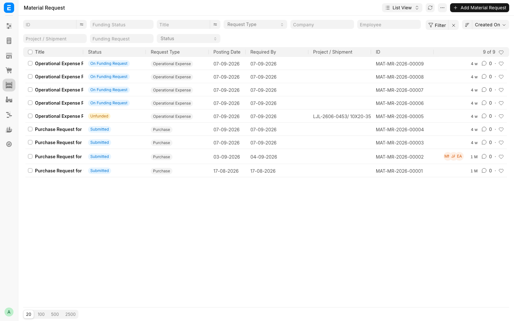
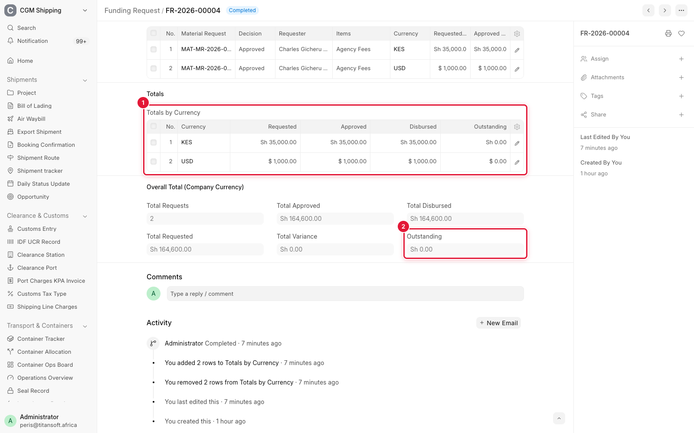

# Funding Request

**Batch Material Requests for approval and payment - operational expense by Journal Entry, purchase by Purchase Order after funding is approved.**

Use this guide when you need cash or a purchase that is **not** a clearance task payment (UCR, shipping line, entry slip, KPA, permits on Tasks). Employee Advance is **not** used for this path.

A typical scenario: An officer raises an Operational Expense Material Request for field disbursements against a Project. Finance pulls open requests onto a Funding Request, an approver sets approved amounts, and Finance posts a Journal Entry to the Default Operational Expense Account.

To access Funding Request, go to:

> Home > CGM Shipping > Funding Request

Also use:

> Home > Stock > Material Request

> Home > Accounting > Journal Entry

> Home > Buying > Purchase Order



## 1. Prerequisites

- **Material Request Purpose** masters as used on site
- User linked to an **Employee** (required for Operational Expense)
- Role to create Material Requests; **Funding Approver** (or site workflow roles) for approval
- **CGM Shipping Settings → Default Operational Expense Account** set for JE posting
- Optional: Project on the Material Request for cost tracking

:::note
Clearance invoices on shipment Tasks use [Finance](finance.md) task payments - not Funding Request.
:::

## 2. How to - choose request type

| Material Request type | After funding approval | Payment / buy path |
|----------------------|------------------------|--------------------|
| **Operational Expense** | Amounts approved on Funding Request | **Journal Entry** (expense + bank/cash). No warehouse / stock indent. May be [multicurrency](#4-how-to---request-in-a-foreign-currency). |
| **Purchase** | Funding must be approved | **Purchase Order** (then PI / Payment Entry as usual) |
| **Subcontracting** | Funding must be approved | **Purchase Order** (same funding gate as Purchase) |

### Operational Expense rules

- Set **Employee** (who receives the cash). Link your User on the Employee record if the field should fill automatically.
- Warehouses are cleared - this is not a stock indent.
- Project can sit on the header (`custom_project`) and copies to item Project dimensions.
- **Multicurrency (Funding Request)** is on by default, so a line may be requested in a currency other than the company's. See [section 4](#4-how-to---request-in-a-foreign-currency).

### Purchase / Subcontracting rules

- You **cannot** create a Purchase Order (or related RFQ / supplier quotation helpers CGM overrides) until the linked Funding Request is **approved**.
- Shipping Line suppliers cannot be used on these Purchase Orders.

## 3. How to - create and approve funding



```
Material Request (Submit)
  → Funding Request (pull / Get Material Requests)
    → Approver sets Approved / Rejected amounts per line
      → Operational Expense → Create Journal Entry
      → Purchase / Subcontracting → Create Purchase Order (only after approved)
```

1. Create and **Submit** each Material Request with the correct type, items, amounts, and Project where relevant.
2. Open **Funding Request** (`FR-.YYYY.-…`) → add submitted Material Requests that are waiting for funding.
3. Submit the Funding Request into the site’s approval workflow (Pending Approval → Approved / Rejected, etc.).
4. Approvers set **approved** (or rejected) amounts per request line - not only a header yes/no.
5. After approval:
   - **Operational Expense:** create Journal Entries from the Funding Request (uses Default Operational Expense Account when configured).
   - **Purchase / Subcontracting:** create Purchase Orders for remaining funded rows.

:::tip
Use **Funding Request Report** and **Material Request Funding** reports to see what is unfunded, on a request, or disbursed.
:::

A funding request gathers the Material Requests it is paying for:



**1** Each row carries its own **decision** and **approved amount**, so a request can be
part-approved without rejecting the whole batch. The Material Requests it draws from:



## 4. How to - request in a foreign currency



Some operational expenses are billed in US dollars: shipping line charges and KPA
charges are the usual ones, and the company holds USD bank accounts for them.

**Multicurrency (Funding Request) is on by default** on an Operational Expense
Material Request, so every item line carries a **Currency** and an **Exchange
Rate** without anyone having to remember to switch it on. Pick the item, then set
the currency on that line and type the rate. Lines stay in the company currency
until you change one, so a shilling request looks and behaves exactly as it always
did.

The rate typed here is an estimate. It exists so the approver can see a shilling
figure, and it is not the rate that reaches the ledger.

The option is only shown on an Operational Expense request, because that is the
only type funded by Journal Entry rather than a Purchase Order, and a Purchase
Order in this flow is always raised in the company currency. Untick it to force
every line back to the company currency.

**Leave the Exchange Rate blank on a foreign line and today's rate is fetched on
save.** It deliberately has no default: a default of 1 would look filled in and
quietly value USD 1,000 at KES 1,000.

The expense account belongs to the **line**, not to the currency, so the two halves
of a mixed request usually post to different accounts. Setting it on the Item or
Item Group saves typing it every time - see
[CGM Shipping Settings](settings.md#allow-any-account-as-item-default).

**It can be corrected after the request is submitted.** The Journal Entry reads the
account off the line when Finance creates it, which can be days later, so a wrong
account no longer means cancelling and re-raising the request. Changing it affects
the **next** entry created from that line; entries already submitted keep the
account they posted to, and correcting those is a Journal Entry matter, not a
Material Request one.

### Columns on the items table

An Operational Expense request shows **Item Code, Quantity, UOM, Currency, Rate,
Amount, Expense Account** and **Required By**. A Purchase request shows the
standard set with Warehouse instead of Currency and Expense Account, because a
Purchase Order in this flow is always raised in the company currency.

That is the default, not a fixed list. Use the gear at the right of the table to
add or remove columns, and your layout is kept for you from then on. **Reset to
default** in the same dialog brings the list above back.

:::note
This grid is driven by code rather than by *In List View* on the DocType. A column
added through Customize Form will not appear here until it is added to the layout
in `public/js/material_request.js`. The gear icon is the supported way to change
what you personally see.
:::

### What the approver sees

Both figures, on both documents.

The Funding Request Totals tab has two parts:

**Totals by Currency** - a table with one row per currency asked for, each showing
Requested, Approved, Disbursed and Outstanding **in that currency**, plus what the
approved figure is worth in company currency. A KES figure is never added to a USD
one.

**Overall Total (Company Currency)** - the same four figures converted and summed
into one number.

| Where | Company currency | Request currency |
|-------|------------------|------------------|
| Material Request | **Total (Company Currency)** | **Totals by Currency**, one line per currency |
| Funding Request | **Overall Total (Company Currency)** section | **Totals by Currency** table |
| Funding Request banner | The blue totals line | A second line, *Requested by currency* |
| Funding Request row | **Requested (Company Currency)** and its approved and disbursed twins | **Requested Amount** and its twins, in the row's own currency |

The overall total is company currency by design. Approval, payment capping and
Outstanding are all decided on one comparable number, which is why a mixed request
still adds up to a single figure an approver can sign against.

A request entirely in the company currency shows no Totals by Currency table, since
one row repeating the overall total below it would be noise.

**A request may mix currencies.** One holding both KES and USD lines becomes **two
Funding Request rows**, one per currency, and later two Journal Entries. It cannot
be paid as one thing: an entry takes money out of a single bank account held in a
single currency. Each row is approved on its own and paid from the account that
matches it, and the Material Request is only marked Disbursed once both are.

### What reaches the ledger

When Finance creates the Journal Entry they are asked which bank account the money
leaves, one per currency on the request. The account must be held in either the
request currency or the company currency, and only Bank and Cash accounts are
offered.

The rate is fetched fresh at that moment, not taken from the request:

1. The provider configured in **Currency Exchange Settings** - the most current
   figure available.
2. Failing that, the newest **Currency Exchange** record on or before the posting
   date.
3. Failing that, the estimate typed on the request, which is named in the entry's
   remark so nobody has to guess which rate a posted entry used.
4. Failing all three, the entry is refused rather than posted at a zero rate.

This is the opposite of ERPNext's own order, which reads stored records first.
With **Allow Stale Exchange Rates** switched on - as it is here - a single
Currency Exchange record entered once would otherwise price every payment made
after it, for good.

The entry is a draft. Nothing is paid until Finance submits it, and the rate, the
date and the bank account can all still be changed before they do.

:::tip
A rate that moves between approval and payment shows up as a real difference
between the approved and disbursed company-currency figures. That is accurate, not
an error. A row is closed on the amount in its own currency, so a rate movement
cannot leave a fully paid request looking short.
:::

## 5. Features - guards and settings

| Guard / setting | Effect |
|-----------------|--------|
| Operational Expense without Employee | Save/submit blocked until Employee is set |
| PO before funding approved | Blocked for Purchase / Subcontracting |
| Default Operational Expense Account | JE lines for ops expense; set in **CGM Shipping Settings** |
| Project on MR | Carried into JE / buying documents for shipment costing |
| Shipping Line supplier on PO | Blocked |
| Multicurrency on a non-Operational request | Not offered; lines are forced back to the company currency |
| Multicurrency unticked on an Operational request | Every line forced back to the company currency on save |
| Material Request with two currencies | Split into one Funding Request row per currency |
| Same request and currency twice on one Funding Request | Blocked as a duplicate |
| Bank account in an unrelated currency | Blocked when creating the Journal Entry |
| No exchange rate from any source | Journal Entry refused rather than posted at zero |
| Allow Any Account as Item Default | Offers every account on an Item or Item Group default, groups and disabled excluded; on by default |

### Who approves

The **Funding Approver** role, and never the person who raised the request. The
approver role is read from the workflow, so a site that routes approval through a
different role gets that one.

If you try to approve your own request the block names the role that is waiting,
so you know what to chase rather than being told to "ask another approver". It
names the role and not the people: a refusal message is the wrong place to publish
who holds a finance role, and any such list goes stale as soon as somebody joins or
leaves. Who currently holds it is a question for the role list.

If nobody besides you holds the role, the message says so, because the request is
then stuck until somebody is given it.

Worth checking on your own site: if the same people hold both **Finance User** and
**Funding Approver**, then raising and approving are only kept apart by this
per-document check rather than by the roles themselves. That is a reasonable
arrangement for a small team, but it means the role list alone will not tell an
auditor who can do what.

### What the status on a Material Request means

| Status | Means |
|--------|-------|
| **Draft** | Not submitted yet |
| **Awaiting Funding** | Submitted and waiting to be picked up on a Funding Request |
| **Unfunded** | An Operational Expense request submitted but not yet on a Funding Request |
| **On Funding Request** | Sitting on a Funding Request that has not been approved |
| **Approved** / **Partially Approved** | The approver has decided; payment has not started |
| **Disbursed** | Every currency on the request has been paid |
| **Rejected** | The approver turned it down |

**Awaiting Funding** was called *Submitted* until October 2026. It was renamed
because every submitted document in Frappe is submitted, so the word said nothing
about what the request was waiting for or who was holding it. Existing requests
were moved by a patch, and the app accepts either name so a site that has not
upgraded still works.

Workflow states on Material Request and Funding Request are site-configured ERPNext Workflows; CGM maps pending / approved / disbursed behaviour in code so Desk and reports stay consistent.

## 6. Features - vs clearance task payments

| | Task payments | Funding Request |
|--|---------------|-----------------|
| **Trigger** | Application / permit task on a shipment | Material Request |
| **Examples** | UCR, Permit, Shipping Line, ENTRY_SLIP, KPA | Petty cash, tools, subcontract services |
| **Objects** | Task finance lines → JE / Payment Entry | Funding Request → JE or PO |
| **Guide** | [Finance](finance.md) | This page |

## 7. Related Topics

- [Finance](finance.md) - two finance paths overview
- [CGM Shipping Settings](settings.md#container--port-settings) - Default Operational Expense Account, Allow Any Account as Item Default
- [Operations](operations.md)
- [Getting Started](process-overview.md)
