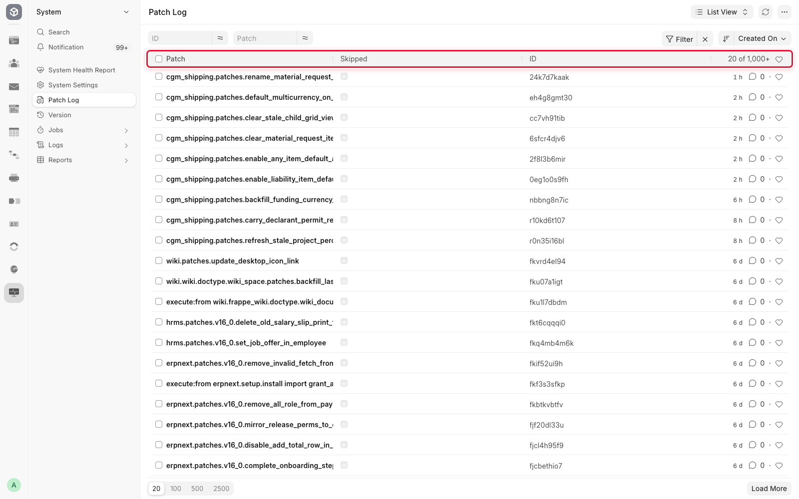

# CGM Shipping - Patch Rules & Lifecycle

Guide for authors adding or cleaning `cgm_shipping` database patches.
Location: `cgm_shipping/patches/` · Registry: `cgm_shipping/patches.txt`

Reference this document **before** creating any new patch.

---

## Principles

1. **Prefer not to patch.** Prefer DocType JSON, `custom/*.json` (Customize Form export), `fixtures/`, or `after_migrate` / `ensure_*` hooks in [`install.py`](../../cgm_shipping/install.py).
2. **Patches are for upgrades.** Fresh installs should get correct schema and masters from DocTypes + fixtures + `after_install` / `after_migrate`, not from one-shot migrations.
3. **A patch runs once.** Frappe records it in Patch Log and never runs it again, and a fresh install marks every patch done without running it. So `patches.txt` holds one-time data fixes only. Config that must stay in step with the code (workflows, notifications, Custom Fields not exported to `custom/*.json`) is a create-if-missing helper called from `install.after_migrate`, so a desk edit survives. One-time migrations that already ran everywhere live in **git history only** (remove from `patches.txt` and delete the file after approval).
4. **Do not delete patches without approval.** Audit first (KEEP / REMOVE / REVIEW), then wait for explicit go-ahead before editing `patches.txt` or removing files.
5. **Never use `--no-verify` or skip Patch Log.** Frappe records executed patches; removing a patch from `patches.txt` does not re-run it, and does not undo work.

---

Frappe records every patch it has run, per site. This list is what "has it already run here?"
means in the checks below:



## When to create a patch

| Situation | Use a patch? | Prefer instead |
|-----------|--------------|----------------|
| New Custom Field / Property Setter that belongs in Customize Form | No | Export to `custom/<doctype>.json` (`bench execute cgm_shipping.install.export_cgm_customizations`) |
| New native DocType field | No | DocType JSON + `bench migrate` |
| Workflow / Notification that must exist on every site | No | Create-if-missing helper called from `install.after_migrate` (see `customizations/workflow_setup.py`, `app_notifications.py`); a fixture only if code should own the whole record |
| One-time data rewrite (rename values, backfill blanks, drop obsolete column) | Yes (one-time) | Plan to **retire** after all staging/production sites have applied it |
| Config that `after_migrate` already calls | No | Add to `install.after_migrate` only - avoid duplicate patch |
| Pre-schema-sync snapshot needed before ALTER | Yes (`[pre_model_sync]`) | Pair with a matching `migrate_*` in `[post_model_sync]` |

---

## Patch categories

### A - KEEP (not yet applied everywhere)

- One-time fixes that some live site has not run yet (no Patch Log row on production).
- Safe to run on a site where the work is already done (early return).
- Ongoing config is never a KEEP patch - it belongs in `install.after_migrate`, which a fresh install also runs.

Currently outstanding, all from the multicurrency work (see
[Funding Request](funding.md)):

| Patch | What it does | Why it cannot be a field default |
|-------|--------------|----------------------------------|
| `backfill_funding_currency_fields` | Stamps the company currency, rate 1 and the company-currency twin on existing Material Request Items and Funding Request rows | The code reads blank as "company currency", so this is cosmetic rather than corrective, but it stops old requests showing an empty Currency column |
| `default_multicurrency_on_operational_expense` | Ticks Multicurrency on existing Operational Expense requests | A DocField `default` only applies to documents created after it ships, so a request raised last week would otherwise behave differently from one raised today |
| `enable_any_item_default_account` | Switches on **Allow Any Account as Item Default** where it has never been set | Same reason: CGM Shipping Settings is a Single created long ago, so its stored value never sees the new default. Respects a deliberate untick |
| `rename_material_request_submitted_state` | Renames the workflow state `Submitted` to `Awaiting Funding` and moves the documents | Workflow records are site data, not shipped in the app. Skips the rename if another workflow has started using the old state |
| `clear_stale_child_grid_views` | Removes saved `GridView` layouts for Material Request Item and Funding Request Material Request | A saved grid layout makes Frappe ignore `in_list_view` entirely, so a column added later never appears for the people who use the form most |

Each one is idempotent and prints what it did. Retire them once staging and
production Patch Log both show them.

### B - SAFE TO REMOVE (one-time / superseded)

Candidates after confirming Patch Log on all live sites:

- One-time `migrate_*`, `backfill_*`, `rename_*`, `drop_*` whose schema is already in DocType JSON and data is migrated.
- Thin aliases that only call another `ensure_*`.
- Seed patches for settings fields that no longer exist on the DocType.
- Patches whose only work is already done in `after_migrate`.

### C - REVIEW MANUALLY

- Removal might break upgrades from older cloud/staging DBs that have not run the patch yet.
- Confirm: `tabPatch Log` on each environment, then reclassify to KEEP or REMOVE.

---

## Naming conventions

| Prefix | Meaning |
|--------|---------|
| `ensure_*` | Helper (not a patch) called from `install.after_migrate`: create what is missing |
| `sync_*` | Helper (not a patch): re-align data with its source of truth |
| `migrate_*` | One-time (or long-lived upgrade) data/schema transform |
| `capture_*` | `[pre_model_sync]` snapshot before ALTER; always pair with `migrate_*` |
| `backfill_*` | One-time fill of blank fields |
| `rename_*` | One-time rename of DocType field, master, or linked values |
| `drop_*` / `remove_*` | One-time cleanup of obsolete column / Custom Field / map |
| `fix_*` | Repair drift (module names, wrong sequences); prefer making them call shared `ensure_*` helpers |
| `seed_*` | Prefer `after_install` / fixtures; patch only if upgrade sites need a one-time fill |

---

## Author checklist (new patch)

1. Read this guide and skim current [`patches.txt`](../../cgm_shipping/patches.txt).
2. Search for an existing `ensure_*` / `install.after_migrate` / fixture that already does the job.
3. Prefer a **shared helper** (e.g. under `customizations/` or `default_seed_data.py`) called from both `after_migrate` and the patch, so the patch can later be removed without losing behaviour.
4. Write a short module docstring: **why**, **what**, **idempotent or not**.
5. Implement `execute()` with early returns when already applied.
6. Add the module path under the correct section in `patches.txt`:
   - `[pre_model_sync]` - only if work must run **before** DocType sync.
   - `[post_model_sync]` - default.
7. Run locally: `bench --site <site> migrate` (or `bench --site <site> execute cgm_shipping.patches.<name>.execute`).
8. If the patch is one-time, file a follow-up: “retire after staging+production Patch Log shows success”.

---

## Retirement checklist (remove patch)

Before deleting a file or line from `patches.txt`:

1. Classify as **REMOVE** in an audit (not REVIEW).
2. Confirm on **every** environment that still matters (local, staging, production):
   - Patch appears in **Patch Log**, **or**
   - Work is proven unnecessary (e.g. column already gone, field no longer on DocType, alias of another patch).
3. Confirm a lasting source of truth remains: DocType JSON, `custom/*.json`, fixture, or `after_migrate`.
4. Get explicit approval.
5. Remove from `patches.txt`, delete the `.py` file, commit.
6. Do **not** delete Patch Log rows.

---

## Duplicates to avoid

| Anti-pattern | Do this instead |
|--------------|-----------------|
| `migrate_foo` + later `ensure_foo` that fully replaces it | Keep `ensure_*` in migrate/hooks; retire `migrate_*` after upgrades done |
| Patch that only calls `after_migrate` helper | Drop the patch; rely on `install.after_migrate` |
| Two `ensure_*` patches where one aliases the other | Keep a single `ensure_*` |
| Seeding masters already in `fixtures/` | Use fixtures + `after_install`; patch only for upgrade backfill |
| Capture without migrate (or migrate without capture for schema renames) | Keep the pair until all sites past the change, then remove **both** |

---

## Related sources of truth

| Kind | Where |
|------|--------|
| App hooks | `cgm_shipping/hooks.py` (`after_install`, `after_migrate`, `fixtures`) |
| Migrate installers | `cgm_shipping/install.py` |
| Workflows, notifications, custom fields code relies on | `…/customizations/workflow_setup.py`, `app_notifications.py`, `app_custom_fields.py`, `sales_invoice_workflow.py` |
| Fresh-install branding | `…/customizations/branding.py` (`after_install` only) |
| Default masters / settings seed | `cgm_shipping/default_seed_data.py`, `…/sea_settings_seed_data.py` |
| Desk customizations | `cgm_shipping/cgm_worldwide_shipping/custom/*.json` |
| Fixtures | `cgm_shipping/fixtures/` (e.g. Container Tracker Mode). CGM Task Template is seed-only so site edits are not overwritten on migrate. |
| Runtime configuration | [CGM Shipping Settings](settings.md) |

---

## Audit labels (for cleanup PRs)

Use these labels when reviewing `patches.txt`:

```
KEEP
- patch_name
  Reason

REMOVE
- patch_name
  Reason

REVIEW
- patch_name
  Reason
```

For each patch, record: purpose, idempotent?, schema/data?, needed for fresh install?, needed for upgrades?, recommendation.
