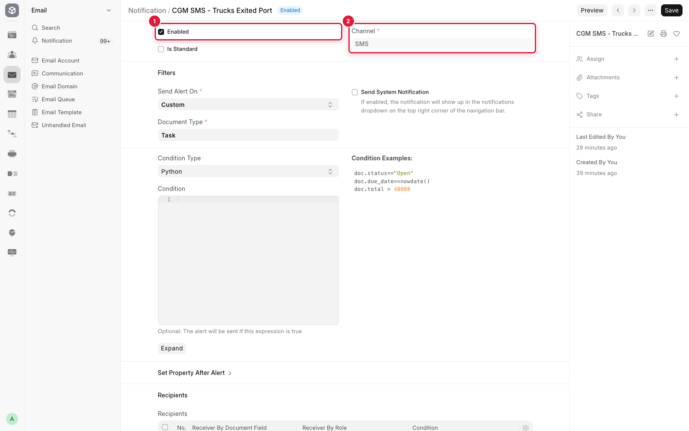
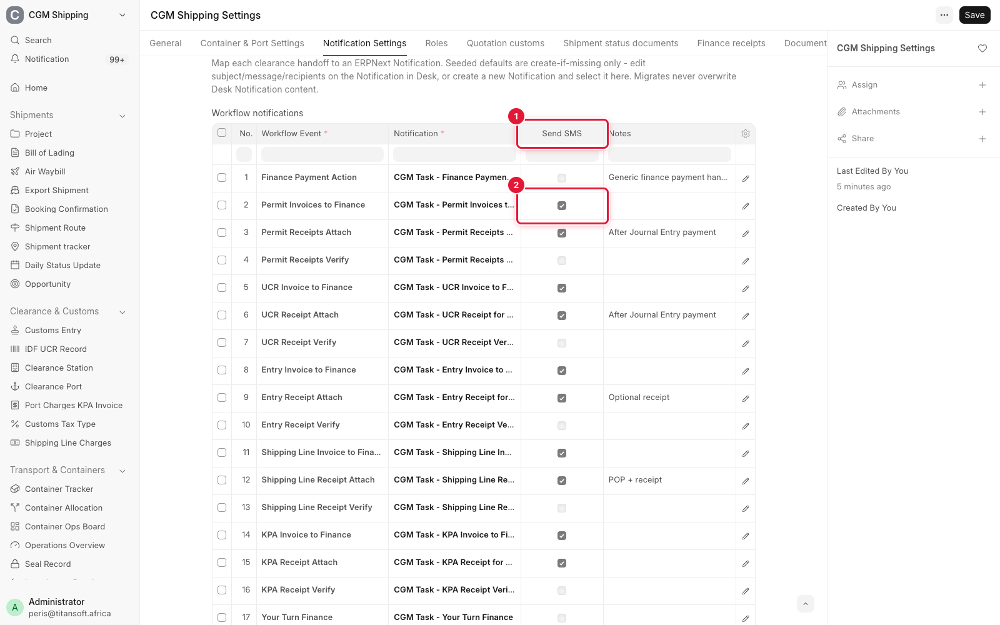
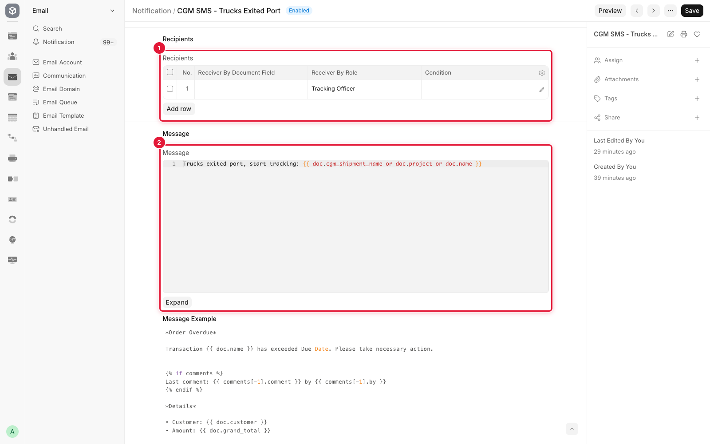
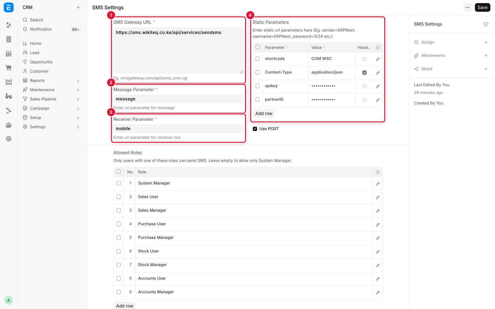

# SMS Notifications

The shipment workflow can text staff at each handoff, alongside the emails it
already sends. A text is one short line naming what happened and the shipment,
for example:

> Trucks exited port, start tracking: LJL-2607-0636 / 7X20 / 13

**Who:** System Manager sets it up. Everyone with a mobile number on their User
record can receive.

**Nothing is sent until it is switched on.** A fresh deployment sends no texts.
Each text costs a credit per recipient, so every one is turned on deliberately,
per site.

---

## What has to be in place

| Requirement | Where | Notes |
|-------------|-------|-------|
| The SMS gateway | **SMS Settings** | See [Gateway setup](#gateway-setup) |
| A mobile number for each recipient | **User** record, *Mobile No* | A user with no number is skipped silently |
| Credits on the SMS account | The provider's portal | A text over 160 characters costs more than one credit |
| The texts switched on | See [Switching texts on](#switching-texts-on) | Off by default |

Numbers can be typed as `0702 822 379`, `+254 702 822 379` or `254702822379`. They
are converted to `2547XXXXXXXX` before sending, which is the form the gateway
accepts.

---

## Two kinds of text

### Step texts

Sent when a step of the **sea import** plan is completed. These steps had no
alert of their own before.

| When this is completed | Notification | Texted to (default) | Text |
|------------------------|--------------|---------------------|------|
| Receive shipment documents from Client | `CGM SMS - Documents Received` | Declarant, Field Operations Officers | Documents received: *shipment* |
| Share documents with Declarants | `CGM SMS - Documents Shared with Declarants` | Declarant | Docs shared, create UCR: *shipment* |
| Receive Final Clearance Documents | `CGM SMS - Final Clearance Documents Received` | Declarant, Field Operations Officers, Operations Manager | Final clearance docs received: *shipment* |
| Finance Pays Entry Slip | `CGM SMS - Entry Ready` | Field Operations Officers | Entry paid and ready: *shipment* |
| Lodge Delivery Order | `CGM SMS - Delivery Order Lodged` | Declarant, Field Operations Officers, Senior Supervisor, Operations Manager, Director | Delivery order attached: *shipment* |
| Prepare Post-Clearance Permits | `CGM SMS - Post-Clearance Permits Ready` | Field Operations Officers | Permits in, start field clearance: *shipment* |
| Field Officers conduct clearance | `CGM SMS - Obtain KPA Invoice` | Senior Supervisor | Clearance done, get KPA invoice: *shipment* |
| Finance pays KPA Invoice | `CGM SMS - Book Trucks` | Field Operations Officers | Payments done, book trucks: *shipment* |
| Book trucks and notify warehouse | `CGM SMS - Load Trucks and Exit Port` | Field Operations Officers | Trucks booked, load and exit port: *shipment* |
| Load trucks and exit port | `CGM SMS - Trucks Exited Port` | Tracking Officer | Trucks exited port, start tracking: *shipment* |

One more belongs with these, although it is not a task:

| When | Notification | Texted to (default) | Text |
|------|--------------|---------------------|------|
| An Opportunity is sent for review (*Pending Approval*) | `CGM SMS - Opportunity Approval Needed` | Operations Manager | Approve shipment *opportunity*: *customer* |

### Handoff texts

Sent at the finance handoffs the system already emails about. The email is
unchanged; the text is extra.

| Workflow event | Notification | Texted to (default) | Text |
|----------------|--------------|---------------------|------|
| UCR Invoice to Finance | `CGM SMS - UCR Invoice to Finance` | Finance | UCR invoice, verify and pay: *shipment* |
| UCR Receipt Attach | `CGM SMS - UCR Paid` | Declarant | UCR paid, attach receipt and IDF: *shipment* |
| Permit Invoices to Finance | `CGM SMS - Permit Invoices to Finance` | Finance | Permit invoices, verify and pay: *shipment* |
| Permit Receipts Attach | `CGM SMS - Permits Paid` | Declarant | Permits paid, attach receipts and permits: *shipment* |
| Shipping Line Invoice to Finance | `CGM SMS - Shipping Line Invoice to Finance` | Finance | Shipping line invoice, verify and pay: *shipment* |
| Shipping Line Receipt Attach | `CGM SMS - Shipping Line Paid` | Documentation | Shipping line paid, POP shared: *shipment* |
| Entry Invoice to Finance | `CGM SMS - Entry Invoice to Finance` | Finance | Entry slip invoice, verify and pay: *shipment* |
| Entry Receipt Attach | `CGM SMS - Entry Slip Paid` | Declarant | Entry slip paid, attach entry and receipt: *shipment* |
| KPA Invoice to Finance | `CGM SMS - KPA Invoice to Finance` | Finance | KPA invoice, verify and pay: *shipment* |
| KPA Receipt Attach | `CGM SMS - KPA Paid` | Senior Supervisor | KPA paid: *shipment* |
| CFS Invoice to Finance | `CGM SMS - CFS Invoice to Finance` | Finance | CFS invoice, verify and pay: *shipment* |
| CFS Receipt Attach | `CGM SMS - CFS Paid` | Senior Supervisor | CFS paid: *shipment* |

The permit pair covers both pre-clearance and post-clearance permits. The CFS
pair is the LCL equivalent of KPA.

"Finance" means the roles on the matching email Notification at the time the SMS
one was created. After that the two lists are separate: changing who gets the
email does not change who gets the text.

---

## Switching texts on

The two kinds are switched in different places.

**Step texts and the opportunity text:** open the Notification (search
**Notification** in the awesome bar, then the `CGM SMS - ...` name) and tick
**Enabled**. They are created unticked.

**Handoff texts:** open **CGM Shipping Settings**, tab **Notification Settings**,
table **Workflow notifications**, and tick **Send SMS** on the event's row. The
handoff's `CGM SMS - ...` Notification is already enabled and waits for that
tick. Unticking **Enabled** on the Notification also silences it.

Ticking **Send SMS** on an event that has no `CGM SMS - ...` Notification of its
own (receipt verification, the *Your Turn* alerts) texts the email's subject line
to the email's recipients. That works, but the subject line is longer than a
written text.

---

## Changing the wording or the recipients

Both are on the Notification record, and a migrate never overwrites them.

- **Wording:** the **Message** field. Keep it under 160 characters once the
  shipment name is filled in, or it is cut at 160. The sender ID already shows who
  it is from, so the texts do not repeat the company name.
- **Recipients:** the **Recipients** table, by role. Every enabled user holding
  the role and a mobile number is texted.

Deleting a `CGM SMS - ...` Notification brings it back, with its defaults, on the
next migrate. To stop a text, untick **Enabled** instead.

---

## What to expect

- **Whole roles are texted.** "The declarant" means every user with the Declarant
  role. The cost of one event is the number of people in its roles, so trimming
  the Recipients table is how the bill is controlled. The delivery order text
  alone reaches five roles.
- **Sea import only for step texts.** Air, road and transit shipments get the
  handoff texts but no step texts.
- **A step the system completes on its own sends no text.** For example, a permit
  application closed automatically when its Finance task finishes. Only a step
  completed by a person saving the task texts anyone.
- **Texts are sent in the background**, a moment after the save. A slow gateway
  never delays the task, and one rejected number does not stop the others.
- **Failures are in the Error Log**, titled *CGM workflow SMS failed*, with the
  text and the numbers that were refused.
- **The "field clearance" text fires when clearance is completed.** The system
  does not record when it starts.

---

## Gateway setup

**SMS Settings** (search it in the awesome bar) holds the connection to the
provider. For an Advanta-based account:

| Field | Value |
|-------|-------|
| **SMS Gateway URL** | `https://<provider host>/api/services/sendsms` |
| **Message Parameter** | `message` |
| **Receiver Parameter** | `mobile` |
| **Use POST** | Ticked |

**Static Parameters:**

| Parameter | Value | Header |
|-----------|-------|--------|
| `apikey` | The account's API key | No |
| `partnerID` | The account's Partner ID | No |
| `shortcode` | The approved Sender ID | No |
| `Content-Type` | `application/json` | Yes |

**Header** unticked means the value travels with the message data. Ticked means
it is sent as a request header, which only `Content-Type` needs.

**Allowed Roles** on that form governs who may send a text by hand. It does not
affect the workflow texts described here.

Confirm the first live text on a phone. A success message on screen only means
the gateway accepted the request.

---

## Related guides

- [CGM Shipping Settings](settings.md) - the Workflow notifications table and its Send SMS tick
- [Operations](operations.md) - the sea import plan the step texts follow
- [Finance](finance.md) - the invoice and receipt handoffs
