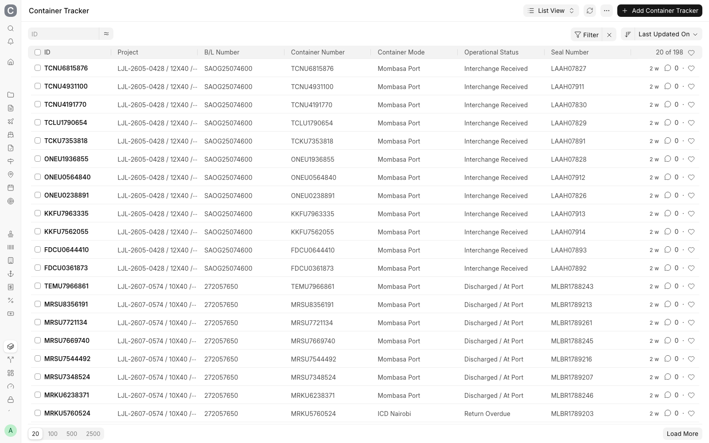
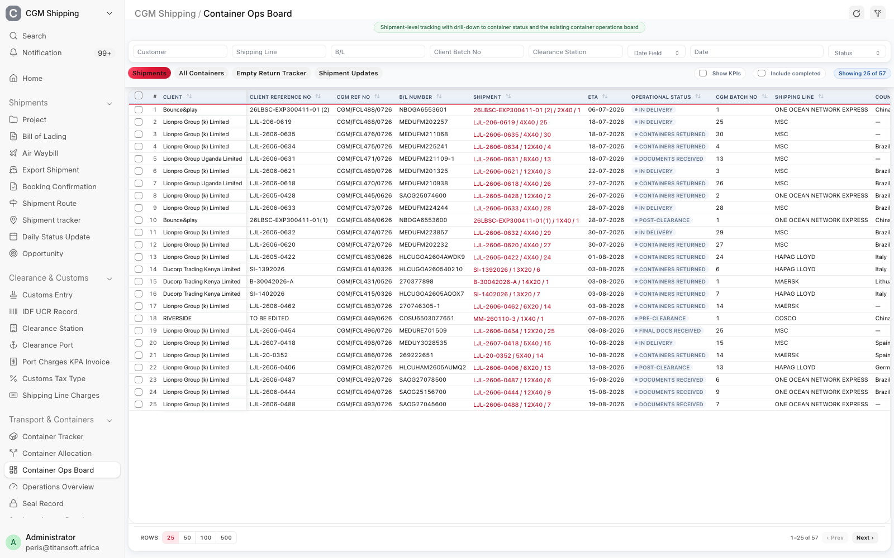
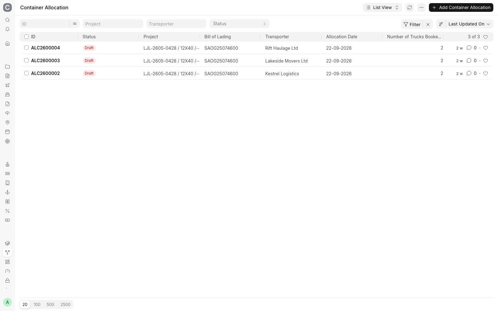
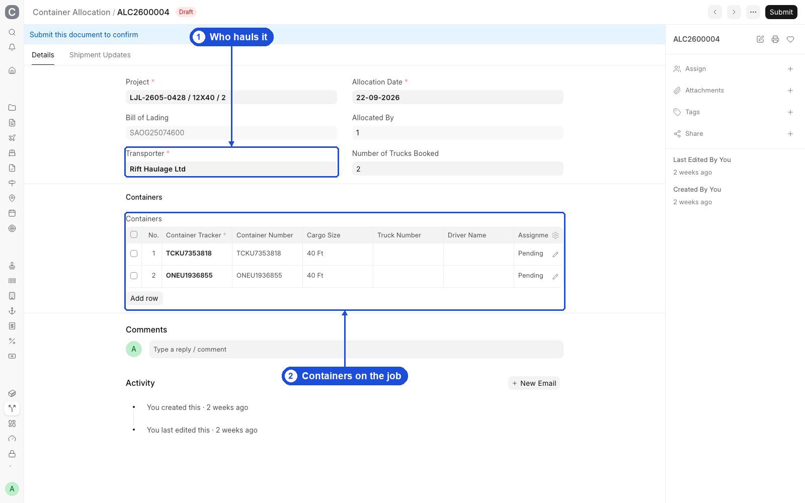
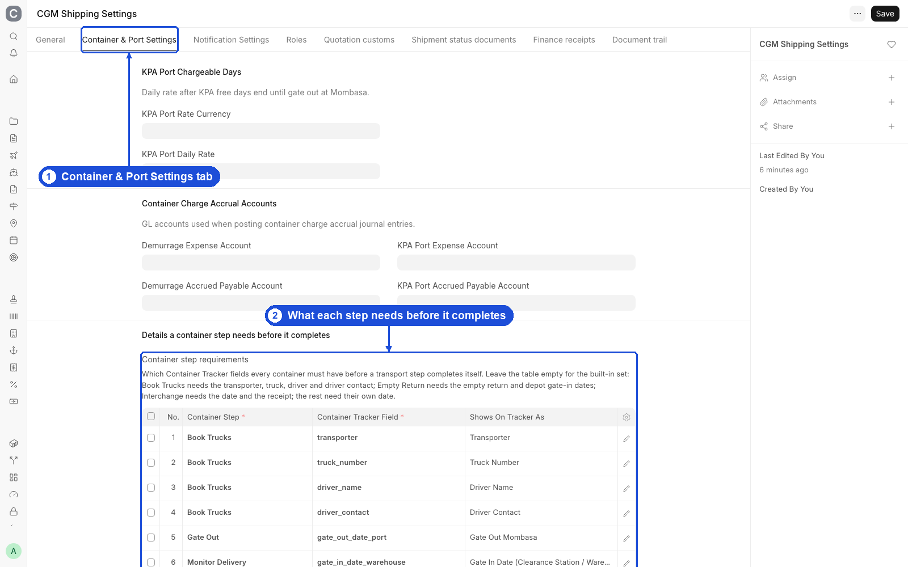

# Transport & Containers Guide

For **transport coordinators** and **operations** managing containers, demurrage, and transporter assignments.

---

## Where to work

| Item | Path in Desk |
|------|----------------|
| Container records | **Container Tracker** |
| Live dashboard | **Container Ops Board** |
| Transporter jobs | **Container Allocation** |
| Empty interchange | **Interchange Receipt** |
| Seal tracking | **Seal Record** |
| Reports | Container Tracking Detail, Container Return Tracker |

---

## Container lifecycle

```
Bill of Lading containers
  → Container Tracker (one record per container_number per project)
    → Task Container Updates (on transport tasks 20–25)
      → Daily metrics refresh (demurrage / detention)
        → Container Ops Board
```

Every container in the system, with where each one has reached:



### Status progression

| Status | Typical trigger |
|--------|-----------------|
| Pending Arrival | Created, vessel not yet berthed |
| Vessel Berthed | ATA / berth date set |
| Discharged / At Port | Discharge date |
| Released / In Transit | Gate out from port |
| At Warehouse | Arrival at CFS / warehouse |
| Cargo Offloaded | Offload confirmed |
| Empty Returned | Empty container at depot |
| Interchange Received | Interchange receipt filed |
| Return Overdue | Past free days / deadline |
| Returned Late (Settled) | Back late, demurrage settled |

Statuses are **derived from dates** on Container Tracker (daily scheduler recalculates charges).

---

## Sea-import transport tasks (20–25)

| Seq | Task |
|-----|------|
| 20 | Book trucks and notify warehouse |
| 21 | Load trucks and exit port |
| 22 | Monitor delivery to destination |
| 23 | Offload cargo |
| 24 | Return empty container to depot |
| 25 | Receive interchange confirmation |

Use **Task Container Update** child table on these tasks to record per-container gate-out, delivery, offload, and return dates.

Each of these completes itself once every container has that step's details. See
[What a step needs before it completes](#what-a-step-needs-before-it-completes).

---

## How a job reaches a transporter

1. **Shipment details arrive** from Documentation.
2. **Documents go to the transporter** - Bill of Lading, and the Delivery Order or container guarantee.
3. **ETA is shared**, then kept current. Tracking runs daily until KRA releases the cargo, and the transporter is updated as it moves.
4. **Transporter sends truck details**, and the containers are allocated to them.
5. **Loading**, after the containers are verified, then the truck exits the port.
6. **The contact person for the shipment** is passed to the transporter, who passes it to the drivers - so the person on the road can reach someone directly.
7. **Delivery Order / container guarantee reaches the drivers**, because that is what they need to return the container afterwards.
8. **Offload, then return the empty** to the appointed depot.
9. **Interchange issued** at drop-off, and shared back to Tracking or Documentation.

Step 9 is the one that pays: the interchange is the proof the container came back, and it is what the **container deposit refund** is claimed against.

**Trucks are booked before the cargo is released**, not after. Planning overlaps clearance so movement starts the moment the entry is released - which is also why the warehouse is told to make space, and have bags and labour ready, while clearance is still running.

---

## Container Ops Board



**Desk:** CGM Shipping → Container Ops Board  
**Route:** `container-ops-board`

Features:

- KPI tiles: overdue returns, demurrage exposure, free days expiring
- Filters: customer, project, B/L, batch, clearance station
- Tabs: **All Containers**, **Empty Return Tracker**
- Column layout: Shipment, Client, B/L, Containers, Batch, etc.

---

## Container Allocation (transporters)

**Container Allocation** assigns containers from a Project/B/L to a **Supplier** (transporter).

- Submittable document
- Child rows: **Container Allocation Item**
- Transporters view assignments at **`/transporter/allocation`**

Transporter suppliers sync portal users on save (`transporter_supplier.py`).

---

Jobs handed to transporters, each with its containers:



Opening one shows the containers on that job and the trucks offered against them:



**1** The **transporter** is the supplier doing the haulage; only suppliers flagged as
transporters can be picked, and only they see the job on the portal.

**2** Container rows start at **Pending**. The transporter offers trucks from their portal;
CGM assigns an offered truck to each container, which is what moves the row on.

## Shipping line charges (Supplier master)

On **Supplier** (shipping line), configure:

| Child table | Purpose |
|-------------|---------|
| Shipping Line Free Days Rule | Free days by destination |
| Shipping Line Demurrage Tier | Demurrage rate tiers |
| Shipping Line Detention Tier | Detention rate tiers |

Used when calculating container charges on Container Tracker.

---

## Interchange Receipt

Submittable confirmation when empty container is returned to depot - links to task 25 completion.

---

## Reports

| Report | Use |
|--------|-----|
| Container Tracking Detail | Full container timeline |
| Container Return Tracker | Empty return focus |
| Container Tracking Report | Summary tracking |

---

## Container Updates and the Container Tracker

The transport details live in two places on purpose. The **Container Tracker** is the
container's own record. The **Container Updates** grid on each transport task is what
the person doing that step fills in, and what the task is judged complete on.

Editing the tracker pushes the relevant fields down to the matching task grids, each
step receiving only its own fields: booking trucks gets the transporter, truck and
driver; gate out gets the same transport details plus the port gate-out and free days;
monitoring delivery gets the warehouse gate-in; empty return gets the return and depot
dates; interchange gets the interchange date and document.

A task's grid also arrives pre-filled with whatever the tracker already holds for that
step, so a step reached late in the job does not start blank.

### What a step needs before it completes

A transport step is not ticked by hand. It completes itself once **every container on
the shipment** carries the details for that step, and it stays open until then.

| Step | Every container must have |
|------|---------------------------|
| 20 Book trucks | Transporter, Truck Number, Driver Name, Driver Contact |
| 21 Load trucks and exit port | Gate Out Mombasa |
| 22 Monitor delivery | Gate In Date (Clearance Station / Warehouse) |
| 23 Offload cargo | Offloading Date |
| 24 Return empty container | Actual Empty Return, Gate In Date Depot |
| 25 Receive interchange confirmation | Interchange Date, Interchange Document |

Booking trucks and returning the empty used to close on one field each, a truck number
and a return date, and the rest of the row could stay blank. A step could therefore be
signed off with no transporter and no driver recorded against the container, and that is
precisely the record wanted months later when a shipping line bills for demurrage and
the question is who held the box and when the depot took it back.

Try to complete a step before its containers are ready and the message names the
containers holding it up and, where a step needs several fields, which of them each one
is short of:

> Transporter, Truck Number, Driver Name and Driver Contact missing on:
> MSCU1234567 (Driver Name), TGHU9998877 (Transporter, Driver Contact)

Fill those on the **Container Tracker** and the task completes itself. Steps already
Completed are left alone; this is a gate on closing a step, not a re-audit of closed
ones.

### The truck on the exit step

**Load trucks and exit port** shows the transporter, truck, driver and contact as well
as its own gate-out fields. The truck that turns up at the gate is not always the one
booked, and the exit step is where that is noticed.

The details are editable there, not just displayed. Correcting the truck on the exit
step updates the Container Tracker, so the tracker holds the truck that actually left.
The Book trucks grid keeps what was booked, because a completed step records what was
done at the time.

Showing the details is not the same as requiring them. Only **Book trucks** refuses to
complete without all four; **Load trucks and exit port** still closes on the gate-out
date alone.

### Changing what a step needs



**CGM Shipping Settings**, tab **Container & Port Settings**, table **Container step
requirements**. One row per field a step requires: pick the **Container Step** and the
**Container Tracker Field**.

- **Leave the table empty** for the set in the table above. An emptied table means the
  defaults, never "nothing required".
- **Rows for a step replace that step's defaults.** Listing only Truck Number against
  Book Trucks goes back to the old single-field behaviour. Other steps are unaffected.
- **Add rows to ask for more**, for example Clearance Station on Monitor Delivery.
- A field that is not on the Container Tracker is ignored rather than waited for, so a
  mistyped row cannot hold a step open with nowhere to go and fill it.

The list sits in Settings because it is a judgement about which details matter, not a
rule of the trade. It was agreed once, and a month of real shipments will move it.

### Details entered after a step was signed off

A finished task used to be skipped entirely, so anything entered on the tracker
afterwards never appeared in its grid. Opening that task later showed nothing, which is
exactly where someone looks when a shipping line invoices for demurrage months on.

Blank cells on a finished task are now filled from the tracker. A cell that already
holds a value is never changed: the finished task records what was done at the time,
and overwriting it would damage the trail rather than complete it. So the rule is:

- **Blank on a finished task** - filled from the tracker.
- **Already filled** - left exactly as it is, even if the tracker now disagrees.
- **Open task** - the live sync handles it, as before.

If a finished task's grid and the tracker disagree, the grid is the record of what was
entered at the time and the tracker is the current truth. That difference is
deliberate, and it is what lets you tell when something was corrected after the fact.


## Demurrage: late but settled

Demurrage is the shipping line's charge for holding its container past the free days.
The line invoices it, Admin receives the invoice and it gets paid. Until that payment
was recorded anywhere, a container that came back late stayed red forever, and moving
the free-days dates to quiet it dropped the status to **Discharged / At Port**, the
colour of a box nobody has touched.

**Container Tracker**, tab **Free Days**, section **Demurrage Settlement**:

| Field | What it is for |
| --- | --- |
| Demurrage Invoice No | The line's invoice. Put the same number on every container it covers |
| Demurrage Currency | Defaults to **USD**, which is how lines bill demurrage. Change it if this one differs |
| Demurrage Invoiced | This container's share of that invoice, in the currency beside it |
| Demurrage Paid By | **Company**, or **Client** when the client settled the line directly |
| Demurrage Settled On | The date it was paid |

Fill in **Demurrage Settled On** for a container that came back late and two things
change:

- It reads **Returned Late (Settled)** in blue instead of orange or red.
- It drops out of the active demurrage figures on the Operations board, and its traffic
  light becomes **AWAITING INTERCHANGE** rather than action needed.

The lateness itself is not erased. The day count stays on the record, because that is
what the line billed for and what anyone reviewing the job later needs to see.

**The return stops the day count, not the payment.** Demurrage is settled as the
container comes back, so the two happen together and the return is the real end of the
charge. If a settlement is recorded while the box is still out, the days keep running,
because they are still being incurred and more will be owed. Nothing is frozen until
the empty is back.

**Demurrage Start Date** on the same tab is the first chargeable day, the day after the
free days end. It is worked out for you and fills in as soon as there is a charge.

---

## Reading container status at a glance

Open **Container Tracker** as a list and each container carries a coloured pill for
its operational status. The colours run with the lifecycle, so a list of a
shipment's boxes can be skimmed for the one that needs attention:

| Colour | Means |
| --- | --- |
| Grey | Not at port yet |
| Yellow | At port: berthed, discharged or KRA released |
| Orange | On the road, or offloaded and not yet back |
| Blue | At the warehouse or destination |
| **Red** | **Return overdue.** A live demurrage alarm |
| Blue | Back late with the demurrage settled, or at the warehouse |
| Green | Interchange confirmed, the box is closed out |

Clicking a pill filters the list to that status.

The colours are set in one place, `CONTAINER_STATUS_TABLE`, and the list, the
container form, the Container Tracking report and the Operations Overview board all
read it. A status with no row in that table is drawn grey rather than guessed at, so
a container showing grey when it should not is a sign the status itself is
unrecognised, not that the colour is wrong.


## Related guides

- [Container Deposits & Charges](deposits-and-charges.md) - deposits, demurrage and KPA charges, and how they reach the ledger

- [Operations](operations.md)
- [Portals](portals.md)
- [Finance](finance.md) (shipping line invoice tasks 12–13)
